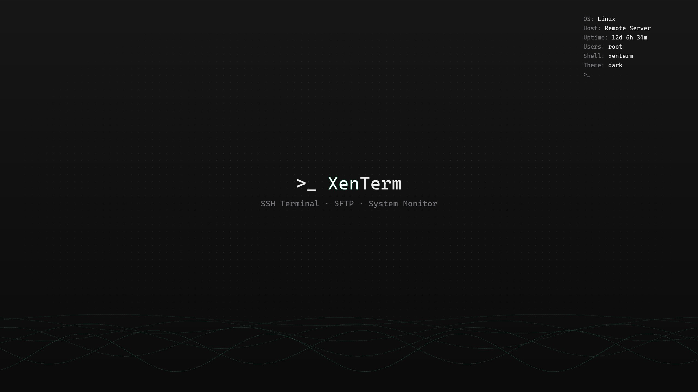
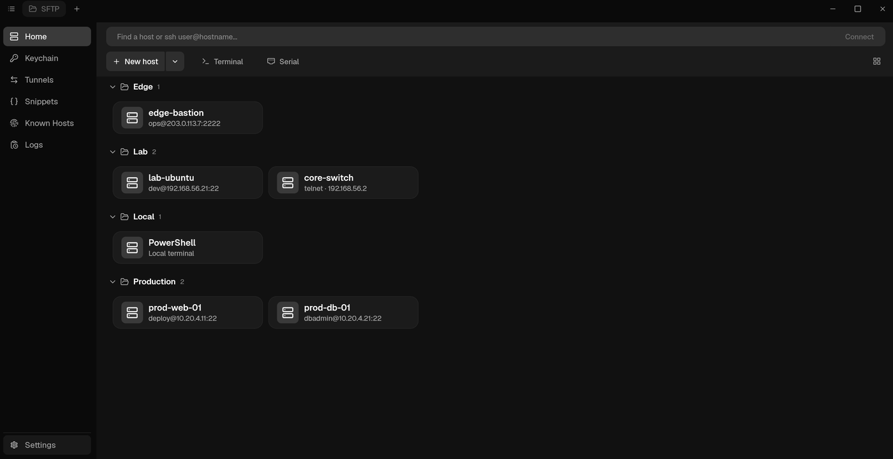
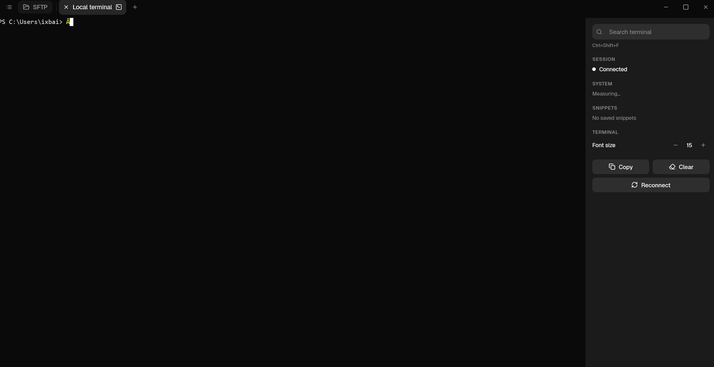
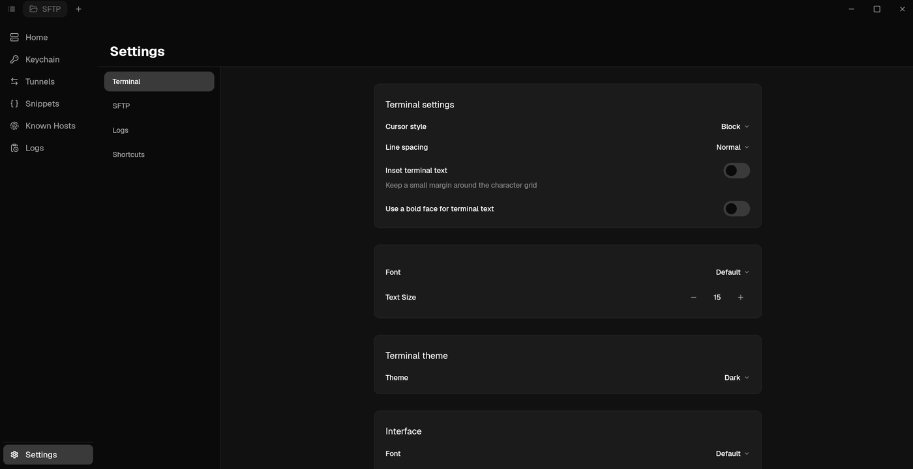
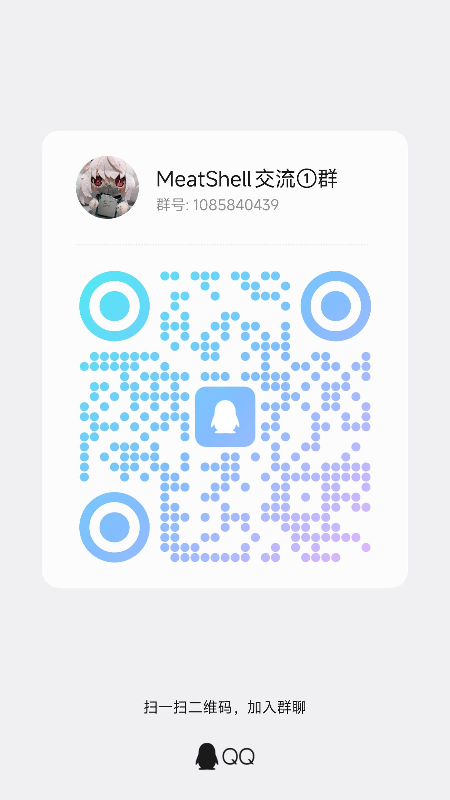

<p align="center">
  <b>English</b> · <a href="README.zh.md">简体中文</a>
</p>

<h1 align="center">XenTerm</h1>

<p align="center">
  <em>A cross-platform SSH / SFTP / Telnet / serial terminal for Windows, macOS and Linux —<br>a Rust core with a Flutter desktop UI.</em>
</p>

<p align="center">
  <a href="https://github.com/ixbaicn/XenTerm/stargazers"></a>
  <a href="https://github.com/ixbaicn/XenTerm/network/members"></a>
  <a href="https://github.com/ixbaicn/XenTerm/releases"></a>
  <a href="https://github.com/ixbaicn/XenTerm/releases"></a>
  <a href="#license"></a>
  
  <a href="https://github.com/ixbaicn/XenTerm/actions/workflows/ci.yml"></a>
</p>

<p align="center">
  
</p>

---

## Overview

XenTerm is a desktop terminal client for people who manage servers: SSH, Telnet and
serial sessions, a full VT terminal, SFTP file management and live resource
monitoring in one window.

The application is split into two layers:

- **`crates/xenterm`** — a Rust service core that owns the protocols (SSH, SFTP,
  Telnet, serial, terminal emulation, local PTYs), the session store, resource
  sampling, the CLI and the MCP server.
- **`apps/xenterm`** — a Flutter desktop UI connected to the core through
  **`xenterm-bridge`**, an in-process FFI bridge.

The core has no UI-toolkit dependency, so the same session store and the same SSH
implementation serve the desktop app, the command line and AI clients — there is
only one server list to maintain.

> **Independent implementation.** XenTerm is an independent project. Its interface
> follows a modern, dark terminal design language and is implemented from scratch.
> It contains no application code, fonts or artwork taken from any other terminal
> product, and the project has no affiliation with, endorsement by, or derivation
> from any other terminal product. Third-party components that are bundled (emoji
> artwork and fonts) are attributed in
> [THIRD_PARTY_NOTICES.md](THIRD_PARTY_NOTICES.md).

| | |
| --- | --- |
| **Sessions** | SSH, local shell, Telnet and serial |
| **Jump hosts** | Ordered SSH bastion chains, with independent credentials per hop |
| **Terminal** | Full VT/ANSI emulation, DEC line drawing and per-session encoding; mouse tracking and colour emoji live in the core |
| **Files** | SFTP panel with upload/download and a transfer strip; ZMODEM lives in the core |
| **Monitoring** | Live local and remote CPU, memory, swap, disk, network and GPU readings |
| **Automation** | `xenterm cli` for scripts and CI, an MCP server for AI clients |
| **Interface** | Flutter desktop UI on shadcn-style components, neutral monochrome theme, light and dark |

## Table of contents

- [Overview](#overview)
- [Screenshots](#screenshots)
- [Installation](#installation)
- [Getting started](#getting-started)
- [Features](#features)
- [CLI and MCP](#cli-and-mcp)
- [Configuration and data](#configuration-and-data)
- [Security](#security)
- [Technology stack](#technology-stack)
- [Project structure](#project-structure)
- [Building from source](#building-from-source)
- [Development](#development)
- [Release](#release)
- [A note on the rewritten commit history](#a-note-on-the-rewritten-commit-history)
- [Community](#community)
- [Contributing](#contributing)
- [Acknowledgements](#acknowledgements)
- [License](#license)

## Screenshots

<p align="center">
  <br>
  <em>Home — saved hosts and groups, with the navigation rail on the left</em>
</p>

<p align="center">
  <br>
  <em>A terminal session, with search, snippets and live system readings in the side panel</em>
</p>

<p align="center">
  <br>
  <em>Settings — terminal, SFTP, logging and shortcut preferences</em>
</p>

## Installation

Every `v*` tag builds the desktop application for each supported platform and
publishes it on the [Releases](https://github.com/ixbaicn/XenTerm/releases) page.
The archive contains the Flutter UI together with the whole Rust core; nothing has
to be installed separately.

### Windows

- **MSI installer** (recommended) — `xenterm-<version>-windows-x86_64.msi`. It is a
  per-machine install under `Program Files`, with Start-menu and desktop shortcuts,
  an entry in *Apps & features*, an in-place upgrade path, and silent-install support
  (`msiexec /i <msi> /qn`). Because the program files are read-only, the profile
  lives in `%APPDATA%`.
- **Portable zip** — `xenterm-<version>-windows-x86_64-desktop.zip`. Unzip it
  anywhere and run `xenterm.exe`. When the folder is writable, the app keeps its
  configuration in a `config/` folder next to the executable, which makes the zip
  suitable for a USB stick.

> **Windows code signing:** XenTerm has applied to the SignPath Foundation
> open-source program. Until the application is approved and the signing pipeline
> is enabled, Windows release artifacts are unsigned and SmartScreen may warn
> about the MSI or zip. Once active, covered Windows releases will use free code
> signing provided by [SignPath.io](https://signpath.io), with a certificate by
> the [SignPath Foundation](https://signpath.org).

### macOS

The download is a `.zip` containing `XenTerm.app`:

```bash
# aarch64 = Apple Silicon, x86_64 = Intel
unzip xenterm-*-macos-*-desktop.zip

# Optional: move it into Applications (running it in place also works)
mv XenTerm.app /Applications/

# Clear the quarantine flag, or macOS reports "XenTerm is damaged and can't be opened"
xattr -dr com.apple.quarantine /Applications/XenTerm.app

open /Applications/XenTerm.app
```

If you did not move it, point both paths above at wherever the `.app` actually is.
macOS 11 Big Sur or later is required.

### Linux

The tarball is a self-contained bundle; GTK 3 is the only system dependency:

```bash
tar -xzf xenterm-*-linux-x86_64-desktop.tar.gz
cd xenterm-*-linux-x86_64-desktop
./xenterm
```

Or use the bundled installer for a managed per-user installation (wrapper in
`~/.local/bin`, PATH managed for new shells, Start-menu and desktop entry):

```bash
./install-linux.sh --user              # never invokes sudo
./install-linux.sh --user --uninstall  # removes only unchanged installed files
```

A system-wide install is `sudo ./install-linux.sh --prefix /opt/xenterm`; it
never guesses the logged-in desktop user, so PATH/desktop integration stays
opt-in via `--user`. See [docs/release.md](docs/release.md) for the layout,
options and uninstall guarantees.

| Distribution | Command |
| --- | --- |
| Arch (AUR) | `yay -S xenterm-bin` (installs the same bundle to `/opt/xenterm`) |

The tarball also ships `install-linux.sh`, the `xenterm.desktop` entry and the
icon for distributions that want to register the application.

### Platform support

| Platform | Architecture | Package |
| --- | --- | --- |
| Windows 10 / 11 | x86_64 | MSI, portable zip |
| macOS 11+ | Apple Silicon (aarch64), Intel (x86_64) | `.zip` with `XenTerm.app` |
| Linux | x86_64 | `.tar.gz`, AUR `xenterm-bin` |

iOS and Android are scaffolded in the Flutter project but are not part of the
desktop release build.

## Getting started

On first launch XenTerm creates an empty session store. Add your first server with
**New host**. The Home toolbar's **Import hosts** reads `~/.ssh/config`, and
**Settings → Profile data** imports a previous XenTerm portable export. The CLI
can additionally import FinalShell connection exports.

The first connection to a server shows its SHA-256 host-key fingerprint for
confirmation. XenTerm remembers trusted keys in its own `known_hosts` file and warns
if a key later changes.

## Features

> **UI status.** The Rust core is feature-complete; the Flutter desktop UI is being
> brought to parity. Items marked **(core)** are available today through the core, the
> CLI and MCP, but are not exposed in the desktop UI yet.

### Sessions and connections

- **Four session types** — SSH, local shell, Telnet and serial, in the same window.
- **Local shell** — the Home toolbar's **Terminal** action opens a temporary
  terminal on the local machine (the system shell), without adding it to the
  session store.
- **Ordered SSH bastions** — route a session through saved SSH jump hosts. The chain
  is resolved outermost first and each hop uses its own credentials; legacy
  single-jump configurations keep working, including nested routes. Cycles,
  duplicates, missing hops and chains longer than 16 hops fail before any network
  activity.
- **SSH authentication** — password, private key, passphrase-protected key, and
  keyboard-interactive prompts for 2FA / OTP.
- **PuTTY `.ppk` keys** — PPK v2/v3 is decrypted and verified in memory; no
  `puttygen` round-trip.
- **Serial** — configurable baud rate, data / stop bits, parity and flow control,
  with an optional console login reply for serial servers that ask for a user name
  and password.
- **Telnet** with an RFC 854/855 option state machine (SGA + NAWS window resizing).
- **Triggers** — expect/send rules for interactive logins, each with its own
  response; saved with the session.
- **Host groups** — create, rename and delete folders, and move sessions between
  them.
- **Temporary sessions** — open a local shell or a serial console without adding it
  to the session store.

### Terminal

- **Full VT/ANSI emulation** — `htop`, `btop`, `vim`, `tmux` and friends render
  correctly full-screen, over a 100,000-line scrollback.
- **Mouse tracking (core)** — SGR and X10 mouse reports are forwarded to TUI
  applications that ask for them, so `htop` and `mc` respond to clicks; the desktop
  UI does not forward pointer events yet.
- **DEC line drawing** — the VT100 special-graphics charset, so `dialog` and `mc`
  frames draw correctly even in UTF-8 mode.
- **Colour emoji (core)** — skin tones, flags and ZWJ sequences render in colour from
  Twemoji images embedded in the core; the desktop UI currently draws system text.
- **Character encodings** — the terminal decodes per-session charsets (UTF-8 by
  default, GBK and others) with a streaming decoder, so a multi-byte character split
  across packets still decodes.
- **Find in the terminal** — search the visible buffer with match highlighting and a
  match count.
- **Fonts and cursor** — any installed monospace family, plus fonts you import, with
  configurable size, line spacing, bold text and padding.
- **Session logs** — optionally record a session transcript and review or delete it
  from the Logs screen.

### Files

- **SFTP panel** that can follow the terminal's working directory, with a
  lazy-loading directory tree.
- **Upload and download** single files or whole directory trees, with progress
  reported in a transfer strip.
- **Directory management** — create and delete remote directories and files.
- **ZMODEM (core)** — `sz` on the remote downloads to your download folder and `rz`
  uploads over the existing PTY; the core handles the transfer, the desktop UI does
  not offer the dialogs yet.
- **Download folder** — configurable in Settings, or ask every time.

### Monitoring

- **Live resource panel** beside the terminal — CPU, memory, swap, per-filesystem
  usage, network throughput and GPU, with state labels instead of hidden failures
  (`waiting`, `stale`, `unavailable`, `unsupported`).
- **Readings from the session's own host** — an SSH session opens an auxiliary SSH
  channel and refreshes the metrics every two seconds without a second login, while
  a local shell samples the local machine.

### Interface and theme

- **One window, one working set** — a navigation rail with Home, Keychain, Tunnels,
  Snippets, Known Hosts and Logs, a settings page, and title-bar tabs for every open
  session.
- **Home** — saved hosts as cards with search, groups, hover actions, and a host
  details drawer for every connection field.
- **Terminal workspace** — the terminal (or its SFTP view) on the left, a tools panel
  on the right with search, copy, clear, font size, snippets, session status and live
  system readings. The rail collapses to give the terminal the full width.
- **Monochrome theme** — a neutral grey scale on black with a white accent, plus a
  light theme; icons and widgets come from a single component set so every screen
  looks like it belongs to the same product.
- **Keyboard shortcuts** are listed on Settings → Shortcuts.

## CLI and MCP

The CLI and the MCP server live in the Rust core and share the sessions saved by the
desktop app, so there is only one server list to maintain. The CLI suits scripts, CI
and explicit commands; MCP lets an AI client do inspection, log analysis and file
transfers from a natural-language request.

Build the core binary from the repository root (the desktop archive ships the core
as a bridge library, not as a standalone executable):

```bash
# Desktop-side automation, including OS keychain access
cargo build --locked --release -p xenterm

# Headless / server deployments without OS keychain backends
cargo build --locked --release -p xenterm --no-default-features --features headless
```

> Connect to the target session in the desktop app at least once first, so the host
> key is confirmed. Passwords and private keys never appear in CLI or MCP output —
> and do not put plaintext passwords into prompts or MCP configuration files.

### CLI

```bash
xenterm cli help
```

```bash
# List saved sessions; the first column is the session-id used below
xenterm cli sessions
xenterm cli sessions --json

# Non-secret metadata for one session
xenterm cli session <session-id>

# Run a non-interactive command; the remote command follows --
xenterm cli exec <session-id> -- free -h
xenterm cli exec <session-id> --timeout 60 --json -- journalctl -n 100 --no-pager

# Browse, read and transfer remote files
xenterm cli files <session-id> /var/log
xenterm cli read <session-id> /var/log/example.log
xenterm cli upload <session-id> ./local.txt /tmp
xenterm cli download <session-id> /tmp/result.txt ./downloads

# Export / import the saved-session store as a portable private file
xenterm cli export new-export.json --include-credentials
xenterm cli import finalshell-export.json --dry-run
xenterm cli sync-native snapshot.json --dry-run

# Read or set the unattended-access mode (restricted | full)
xenterm cli permissions
xenterm cli permissions restricted
```

Downloads require an existing local destination directory and will not overwrite a
file of the same name.

### MCP

The MCP server exposes the same sessions over local stdio. MCP is disabled by
default, and each capability — using saved credentials, running arbitrary SSH
commands, transferring files — is gated separately; enable only what a given client
needs. The unattended-access mode can be read or changed with
`xenterm cli permissions`, and credentials are never returned to the client.

Register the stdio server in your MCP client:

```json
{
  "mcpServers": {
    "xenterm": {
      "command": "/absolute/path/to/xenterm",
      "args": ["mcp", "serve"]
    }
  }
}
```

On Windows, `command` can be `C:\\path\\to\\xenterm.exe`. After restarting or
refreshing the client you should see an `xenterm` server exposing nine tools:
`list_sessions`, `get_session`, `run_command`, `list_remote_files`,
`read_remote_text_file`, `upload_file`, `download_file`, `get_access_policy` and
`import_sessions`. MCP configuration files live in different places per client, so
check that client's documentation.

For a read-only OOM diagnosis, a client can list sessions, run `free -h` and inspect
kernel OOM records, then browse a heap-dump directory — all within the permissions
you granted. If several sessions share a host, name the session in the prompt.

Remote (HTTP) MCP is an opt-in mode that verifies OAuth access tokens from an
external identity provider behind your own HTTPS reverse proxy. It creates no public
listener, account or deployment by itself. See
[remote MCP deployment and verification](docs/REMOTE_MCP.md), including OpenResty
routing for multiple MCP services on one domain.

## Configuration and data

XenTerm is **portable-first**: if a writable `config/` folder sits next to the
executable (a USB stick, an extracted tarball), everything lives there. Otherwise it
falls back to the per-user OS config directory:

| Platform | Location |
| --- | --- |
| Windows | `%APPDATA%\xenterm\XenTerm\config` |
| Linux | `~/.config/xenterm` |
| macOS | `~/Library/Application Support/dev.xenterm.XenTerm` |

All user data lives in that one directory:

- `sessions.db` — the session store (SQLite, WAL mode)
- `secret.key` — the per-install key used when no OS keychain is available
- `known_hosts` — host keys trusted by XenTerm (its own format, not OpenSSH's)
- `log/` — diagnostics, beside the configuration directory

An older `sessions.json` is imported once, kept beside the database as
`sessions.json.migrated`; existing files are never overwritten. For services and
automation, `--data-dir <path>` or `XENTERM_DATA_DIR` pins an explicit, isolated
profile before the store is opened. Concurrent writers detect stale snapshots
instead of overwriting newer saves; see
[profile consistency](docs/profile-consistency.md) and
[configuration import](docs/config-import.md).

## Security

- **Passwords at rest** go to the OS keychain (Windows Credential Manager, macOS
  Keychain, Linux Secret Service) whenever it is available. When it is not, they are
  encrypted with **ChaCha20-Poly1305** under a per-install key in `secret.key`, so
  `sessions.db` never contains a plaintext password.
- **Exported connection lists are portable, not secret.** The export format uses a
  fixed key compiled into the binary so a file opens on any machine — that is
  obfuscation, not encryption to rely on. Keep exports private.
- **Host keys** are remembered by XenTerm itself in its own `known_hosts` file
  (`host:port <key-type> <base64>`), which is not OpenSSH's file. Unknown keys ask for
  confirmation; a changed key produces a hard warning.
- **Secrets are zeroed on drop**, so plaintext credentials do not linger in freed
  memory.
- **MCP is opt-in and gated** — the server and each capability are off by default,
  credentials are never returned to clients, and command/file access requires an
  explicit permission grant.

## Technology stack

| Layer | Choice |
| --- | --- |
| UI | Flutter + [shadcn_flutter](https://pub.dev/packages/shadcn_flutter) widgets |
| Bridge | hand-written C ABI over [`dart:ffi`](https://dart.dev/interop/c-interop) (`xenterm-bridge`) |
| Async runtime | [`tokio`](https://tokio.rs) |
| SSH / SFTP | [`russh`](https://crates.io/crates/russh) + [`russh-sftp`](https://crates.io/crates/russh-sftp) — pure Rust, no libssh |
| Terminal emulation | [`rio-vt`](https://crates.io/crates/rio-vt) native grid, scrollback and reflow |
| Local PTY | [`portable-pty`](https://crates.io/crates/portable-pty) |
| Serial ports | [`serialport`](https://crates.io/crates/serialport) |
| System metrics | [`sysinfo`](https://crates.io/crates/sysinfo) |
| Storage | [`rusqlite`](https://crates.io/crates/rusqlite) (bundled SQLite), [`keyring`](https://crates.io/crates/keyring), [`chacha20poly1305`](https://crates.io/crates/chacha20poly1305) |
| MCP | [`rmcp`](https://crates.io/crates/rmcp) + [`axum`](https://crates.io/crates/axum) |
| Serialization / logging | `serde`, `serde_json`, `tracing` |

## Project structure

```
XenTerm/
├── crates/
│   └── xenterm/                 # Rust service core
│       ├── src/
│       │   ├── app/             # session runtime and the PTY pump
│       │   ├── automation/      # unattended-access policy
│       │   ├── cli/             # `xenterm cli`
│       │   ├── config/          # sessions.db, credentials, import/export, profile locks
│       │   ├── core/            # toolkit-free state shared by every entry point
│       │   ├── mcp/             # MCP server (stdio and optional authenticated HTTP)
│       │   ├── resource/        # local sampling and remote metric parsing
│       │   ├── session/         # connection lifecycles for SSH / local / Telnet / serial
│       │   ├── ssh/  sftp/  tunnel/
│       │   ├── terminal/        # VT engine, charsets, render model, ZMODEM
│       │   ├── webdav/          # manual session sync
│       │   └── frontend.rs      # public session facade used by the bridge
│       ├── tests/               # Rust and Python end-to-end suites
│       └── build.rs             # version injection and Windows icon embedding
├── apps/
│   └── xenterm/                 # Flutter desktop UI
│       ├── lib/                 # screens, shell, terminal view, theme, widgets
│       ├── native/              # xenterm-bridge: C ABI over the core
│       ├── tool/                # build, stage, package and installer scripts
│       └── windows/ linux/ macos/ ios/ android/   # Flutter platform runners
├── assets/                      # icons, bundled fonts and the desktop entry
├── packaging/                   # AUR recipe, Windows MSI definition, remote-MCP examples
├── scripts/                     # version.sh, release.ps1, make_icons.py, install-wix.ps1
├── docs/                        # design notes and operational documentation
└── .github/workflows/           # CI, release and AUR publishing
```

## Building from source

Requirements:

- **Rust** 1.88 or newer (the workspace pins its members in `Cargo.toml`)
- **Flutter** 3.47 or newer, stable channel (CI builds with 3.47.7)
- Platform toolchains: Visual Studio C++ build tools on Windows, Xcode on macOS,
  and the GTK development packages on Linux

On Debian/Ubuntu, the Linux build needs:

```bash
sudo apt update
sudo apt install -y --no-install-recommends \
  build-essential pkg-config cmake ninja-build clang \
  libgtk-3-dev liblzma-dev libstdc++-12-dev \
  libudev-dev libdbus-1-dev
```

Build the bridge library first, then the Flutter application:

```bash
cargo build --release --locked -p xenterm-bridge

cd apps/xenterm
flutter pub get
flutter build windows --release     # or linux / macos
```

`apps/xenterm/tool/bundle_native.sh` copies the bridge next to the built app
(`build/windows/x64/runner/Release` on Windows). Run it once after building — and
before the first `flutter run` during development:

```bash
bash apps/xenterm/tool/bundle_native.sh
```

`apps/xenterm/tool/package_desktop.sh <version>` produces the release archive used by
the workflows.

## Development

Before contributing, read the [contribution guide](CONTRIBUTING.md) (also available
in [简体中文](CONTRIBUTING.zh-CN.md)) for PR scope, conflict handling, review
readiness and API compatibility checks.

- **The UI is Flutter only.** The core must stay free of UI-toolkit dependencies: it
  is linked as a library into the desktop app and built as a standalone CLI on
  servers.
- **The bridge is a thin translator.** `apps/xenterm/native/` maps core types to the
  JSON and handles the Dart side uses; behaviour belongs in `crates/xenterm`.
- **Core modules are feature packages.** Each module keeps data structures under
  `struct/`, implementations under `impls/`, and exposes a small facade through its
  `mod.rs`.
- Useful commands from the repository root:

  ```bash
  cargo check --locked
  cargo test --locked
  cargo test --locked --no-default-features --features headless
  cd apps/xenterm && flutter pub get && flutter analyze && flutter test
  ```

- The Python suites under `crates/xenterm/tests/` cover CLI, MCP, import/export and
  SSH jump-chain behaviour end to end; `docs/` describes the operational details.

## Release

Do not bump the crate version by hand and then tag it. Use the release helper so the
tag points at a commit that already carries the matching version:

```powershell
.\scripts\release.ps1 v0.8.0 -Push
```

The release workflow verifies that the tag matches the version in
`crates/xenterm/Cargo.toml` and `Cargo.lock`, builds the desktop archives for Windows,
macOS (Apple Silicon and Intel) and Linux, and attaches them to the GitHub Release in
one step. See [docs/release.md](docs/release.md) for the full process and
[docs/versioning.md](docs/versioning.md) for the version-string specification.

## A note on the rewritten commit history

In October 2026 the maintainers rebuilt this repository's commit history and
published XenTerm as a new project. Both the interface layer — a Flutter desktop UI
replacing the previous one — and the Rust core were rewritten on a different
architecture, so the earlier history no longer described the code in this
repository.

Consequently, commit links, blame annotations, and references to earlier commits or
pull requests from before October 2026 no longer resolve. We apologize for any
inconvenience this causes readers who bookmarked or cited them. Release notes from
before the rewrite are preserved in the [CHANGELOG](CHANGELOG.md); the source code,
license and feature set are unaffected.

## Community

Questions, bug reports and feature requests are welcome in
[GitHub Issues](https://github.com/ixbaicn/XenTerm/issues). For Chinese-speaking
users there is also a QQ group:

<p align="center">
  <br>
  <em>Scan to join the QQ group for usage questions and release news</em>
</p>

## Contributing

Contributions are welcome. Please read the [contribution guide](CONTRIBUTING.md)
first; it covers the PR workflow, verification commands and review expectations.
Small, focused pull requests are easiest to review. The community follows the
[Code of Conduct](CODE_OF_CONDUCT.md). Report security issues privately as
described in [SECURITY.md](SECURITY.md) rather than in a public issue.

## Acknowledgements

- [Flutter](https://flutter.dev) and [shadcn_flutter](https://pub.dev/packages/shadcn_flutter) for the UI layer
- [Lucide](https://lucide.dev) icons and [Simple Icons](https://simpleicons.org) for the icon set
- [rio-vt](https://crates.io/crates/rio-vt), [russh](https://crates.io/crates/russh),
  [russh-sftp](https://crates.io/crates/russh-sftp), [portable-pty](https://crates.io/crates/portable-pty),
  [serialport](https://crates.io/crates/serialport), [sysinfo](https://crates.io/crates/sysinfo),
  [tokio](https://tokio.rs), [rusqlite](https://crates.io/crates/rusqlite) and [rmcp](https://crates.io/crates/rmcp)
  for the Rust core
- [Twemoji](https://github.com/jdecked/twemoji) for the colour emoji artwork
- The Meatshell Mono, MiSans and HarmonyOS Sans typefaces, attributed in
  [THIRD_PARTY_NOTICES.md](THIRD_PARTY_NOTICES.md)
- The [MeatShell](https://github.com/yituorou/meatshell) project, whose portable
  export format and profile migration path XenTerm keeps for compatibility

## License

Released under the [MIT license](LICENSE). Contributions are accepted under the same
terms.

Third-party attributions — including the Twemoji artwork used for colour emoji and
the bundled fonts — are in [THIRD_PARTY_NOTICES.md](THIRD_PARTY_NOTICES.md).
